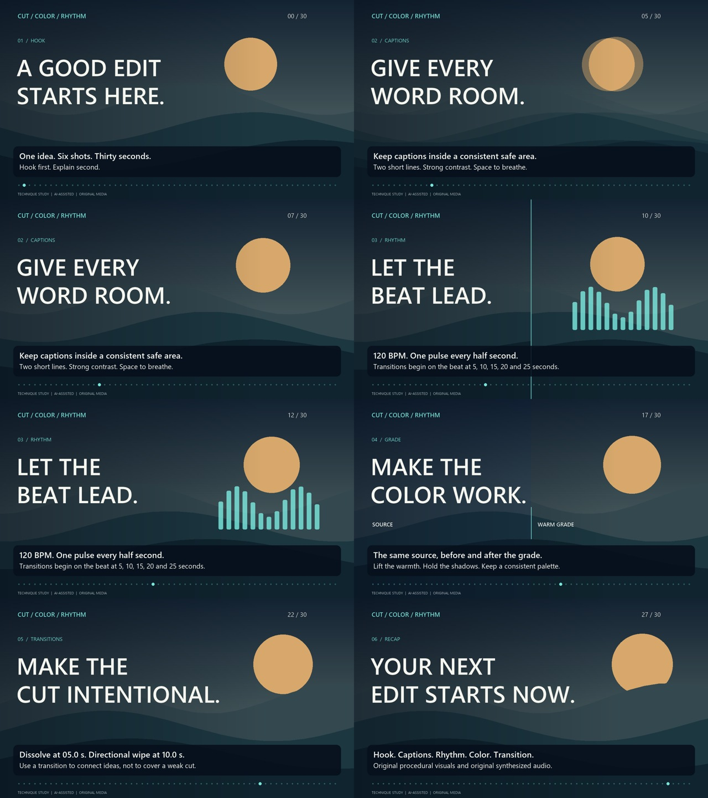

# Cut / Color / Rhythm — 30-second editing study

An original, AI-assisted procedural motion-graphics sample for learning video-editing techniques. The visuals, titles, animation and synthesized soundtrack were created for this study. No stock footage, third-party music, client media or personal information is included.

[Download the MP4](https://github.com/casperhenriksson-sudo/video-edit-technique-study/releases/download/v1.0/thirty-second-edit.mp4)

## What to look for

| Time | Technique |
| --- | --- |
| 00–03 s | Immediate two-line hook: “A good edit starts here.” |
| 05–10 s | Captions inside a fixed lower safe area, with a dark backing and two short lines. |
| 10–15 s | Original 120-BPM soundtrack and visual pulses every 0.5 seconds. |
| 15–20 s | Source/graded split view: saturation, contrast and warm RGB tone curves applied to the same generated landscape. |
| 20–25 s | Transition explanation and visual continuity. |
| 25–30 s | Recap and a short closing fade. |

There are two transition types: **cross-dissolves** begin at 5, 15 and 25 seconds; **left-to-right wipes** begin at 10 and 20 seconds. Each lasts one second. Their starts land exactly on soundtrack beats. Titles stay above the footage transition, cutting cleanly on the beat so letterforms never cross-fade into each other.

## Apply the technique in an editor

1. Create a 1280 × 720, 24-fps sequence and mark every half second for 120 BPM.
2. Put six shots at 0, 5, 10, 15, 20 and 25 seconds, with one second of footage overlap for each transition.
3. Alternate a one-second dissolve and a directional wipe. Keep text on a separate upper track.
4. Leave at least 48 px around the lower caption backing. Use readable contrast and short lines.
5. Apply one consistent grade, then compare the untreated and treated image using a split view.
6. Put an audio accent on each beat; start scene changes and title changes on matching markers. Fade the end over the final half second.

## Format and verification

Delivery: MP4, H.264/yuv420p video, AAC stereo audio, 30 seconds, 1280 × 720, 24 fps. `render-metadata.json` records the delivered file hash and technical measurements. Encoding and full decoding are checked before publication. The contact sheet provides stills for inspecting text, transitions and grading; transition midpoints are included intentionally.



## Source

`render.py` draws the original footage with Pillow, synthesizes original audio with NumPy, composites the edit and encodes it with FFmpeg. It requires Python 3.12 or later, the packages in `requirements.txt`, and a Segoe UI or DejaVu Sans font installation. Fonts and FFmpeg executables are not redistributed in this repository.

```sh
python -m pip install -r requirements.txt
python render.py --ffmpeg /path/to/ffmpeg
python verify.py output/thirty-second-edit.mp4 --ffmpeg /path/to/ffmpeg
```

The `imageio-ffmpeg` package includes a platform-specific FFmpeg executable; `imageio_ffmpeg.get_ffmpeg_exe()` returns its location. The script writes generated artifacts into `output/`. The verification checks every decoded video frame, audio format and peaks, 59 beat accents, and title/caption widths. The accompanying notes describe this actual procedural edit and the visible technique.
